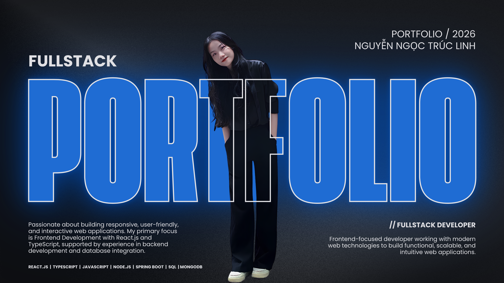

  

# Hi 👋, I'm ALIN

### Fullstack Developer | Frontend Focused

I'm a Fullstack Developer with a strong focus on Frontend Development, particularly React.js and TypeScript. I enjoy building responsive, intuitive, and user-friendly web applications, transforming ideas and designs into functional digital experiences. Beyond frontend development, I have experience working with Node.js, Java, Spring Boot, MongoDB, and SQL to support fullstack applications.

---

### 👩‍💻 About Me

I'm a Fullstack Developer with a strong focus on Frontend Development.

- 💻 Frontend development with ReactJS and TypeScript
- ⚙️ Backend development with Node.js and Spring Boot
- 🗄️ Database experience with MongoDB and SQL
- 🎨 Passionate about UI design and interactive web experiences

---

### 🛠️ Tech Stack

---

### 🚀 Featured Projects

| Project | Description |
|---------|-------------|
| KINGBAY | Chess-themed website |
| WOOJIN | Fullstack web application |
| EduLinkTutor | Tutoring and education platform |
| FCE | Web application |
| Covuakingbay | Chess-related web project |

---

<h2 align="center">💻 Development Focus</h2>

  Building modern, responsive, and user-friendly
  web applications.

<table align="center">
  <tr>
    <td align="center" width="50%">
      <h3>🎨 Frontend Development</h3>
      ReactJS · TypeScript · JavaScript
       
      HTML5 · CSS3
    </td>
    <td align="center" width="50%">
      <h3>⚙️ Backend Development</h3>
      Node.js · Java · Spring Boot
       
      REST APIs
    </td>
  </tr>
  <tr>
    <td align="center">
      <h3>🗄️ Database</h3>
      MongoDB · SQL
    </td>
    <td align="center">
      <h3>🚀 Tools & Deployment</h3>
      Git · GitHub · Vite · Vercel
    </td>
  </tr>
</table>

  <strong>Clean Code • Responsive Design •
  Fullstack Development</strong>

---

---

### 📬 Connect With Me

[GitHub](https://github.com/Alin-dev0911)

